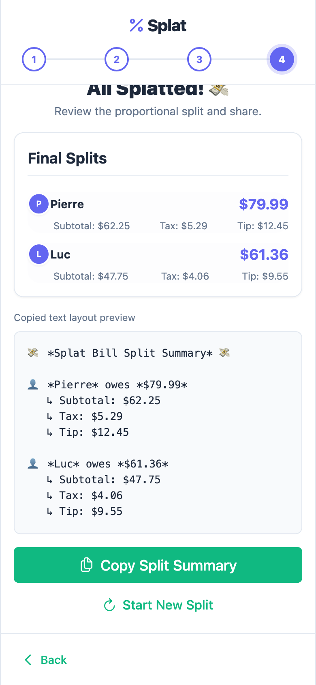

# 💸 Splat — Neobrutalist Proportional Bill Splitter

Splat is a high-contrast, neobrutalist, streetwear-style progressive web application designed to take the friction out of splitting dinner and drinks bills. Simply snap/upload a receipt, let Gemini extract the items, assign shares, and copy a clean text breakdown to send to your group.



---

## 🎨 Design Aesthetic: Neobrutalism
Splat breaks away from boring modern minimalism. It embraces **streetwear neobrutalism**:
- **Fat Stroke Borders**: Heavy, solid `3px` black outlines on all components.
- **High-Contrast Blocks**: Electric hot pink, neon cyan, and neon yellow shadows.
- **Dynamic Angles**: Cards and stickers tilt playfully (`-1.5deg` to `1.5deg`) on hover or active states.
- **Handmade Details**: Monospace receipt stickers, dotted background textures, and custom handwritten headings (`Permanent Marker` & `Lilita One` fonts).

---

## 🔥 Key Features

### 1. Smart AI OCR Scanning (powered by Gemini)
- Upload any image/photo of a receipt.
- Automatically extracts item descriptions, individual prices, tax, and tip.
- **Auto-Currency Detection**: Detects currency symbols (`$`, `€`, `£`, `¥`, etc.) based on the receipt content.
- Preconfigured local environment integration via Vite `.env` config variables.

### 2. Manual Entry Bypass
- Skip OCR scanning entirely with the **✍ Manual** split setup.
- Quickly build receipts from scratch.

### 3. Tactile Mobile-First Cost Allocation
- **Tactile Checkbox UX**: Tap-friendly rows highlighting neon pink when selected, coupled with playful neobrutalist custom checkboxes that scale and rotate.
- **Dynamic "Everyone" Badging**:
  - **$\ge$ 50% Share**: Compresses badges into `Everyone` minus unassigned participants (e.g. `Everyone` `-P2` `-P4`) to save screen space.
  - **< 50% Share**: Shows only the active blue initials badges to avoid clutter.
- **Full Names Toggle**: Switch instantly between initials circles and full-name rectangular capsules.

### 4. Proportional Split Calculation
- Computes tax and tip proportionally based on the cost of the items each participant ordered.

### 5. Shareable Summary Copy
- Generates a cleanly formatted text message ready to be copied and pasted straight into WhatsApp, Discord, or iMessage.

---

## 🛠 Tech Stack
- **Framework**: [Vue 3](https://vuejs.org/) (Composition API, `<script setup>`)
- **Build Tool**: [Vite](https://vitejs.dev/)
- **Styling**: Vanilla CSS (custom design tokens) & [TailwindCSS](https://tailwindcss.com/)
- **UI Toolkit**: [PrimeVue](https://primevue.org/) components
- **Testing**: [Vitest](https://vitest.dev/)
- **AI Integration**: [Google Gemini Developer API](https://ai.google.dev/)

---

## 🚀 Getting Started

### Prerequisites
Make sure you have [Node.js](https://nodejs.org/) installed (v18+ recommended).

### Installation
1. Clone this repository:
   ```bash
   git clone https://github.com/MickRheault/splat.git
   cd splat
   ```
2. Install dependencies:
   ```bash
   npm install
   ```

3. Setup environment variables:
   Copy the example environment template and add your Gemini API Key:
   ```bash
   cp .env.example .env
   ```
   Edit `.env` and set:
   ```env
   VITE_GEMINI_API_KEY=your_gemini_api_key_here
   ```

### Running Locally
Start the development server:
```bash
npm run dev
```
Open your browser and navigate to `http://localhost:5173`.

### Running Tests
Execute the unit test suite:
```bash
npm run test
```

### Production Build
Build and optimize the application for production:
```bash
npm run build
```

---

## 📂 Project Structure
```
├── src/
│   ├── App.vue         # Main layout, steps, modals, and user flow
│   ├── store.ts        # Central reactive state manager & Gemini AI parsing API
│   ├── style.css       # Core design system, neobrutalist style overrides, and variables
│   ├── store.test.ts   # Core business logic tests (Vitest)
│   └── main.ts         # Application entry point
├── public/             # Static public assets (icons, favicons)
├── screenshots/        # Visual step-by-step previews
└── vite.config.ts      # Vite project config
```
