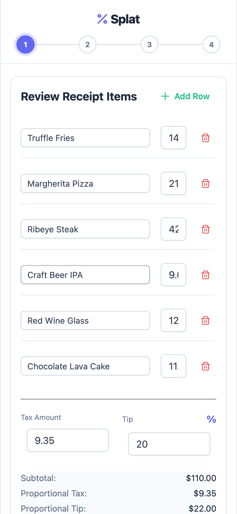
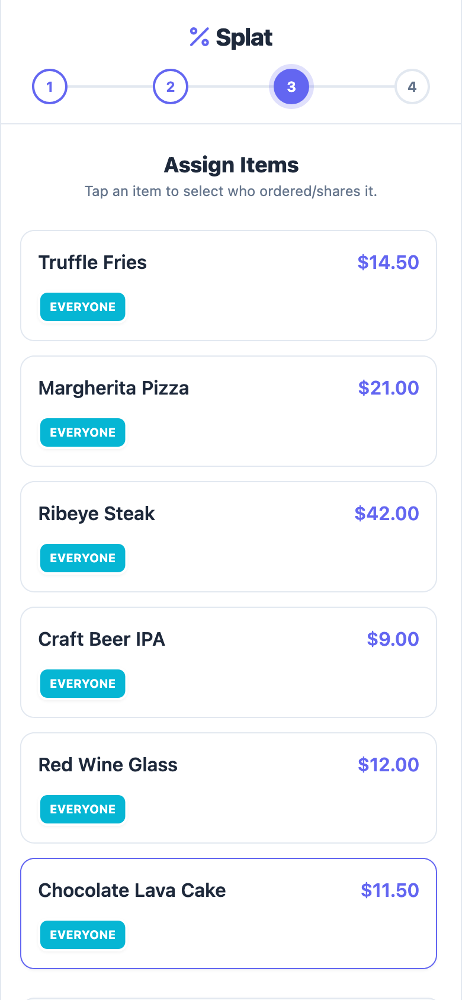

# Splat

Intelligent, camera-enabled bill allocation application. Splat turns a photo of a bill into structured items and adjustments, supports fine-grained item allocations across participants, and calculates penny-accurate proportional adjustments.

**[Try the live app →](https://splat-bills.vercel.app/)**

[](https://github.com/MickRheault/splat/actions/workflows/ci.yml)
[](https://github.com/MickRheault/splat)
[](https://www.typescriptlang.org/)
[](https://vuejs.org/)
[](https://capacitorjs.com/)

---

## App preview

| Review Items & Adjustments | Allocate to Participants | Set Assigned Quantity | Itemized Breakdown |
| :---: | :---: | :---: | :---: |
|  |  |  |  |

---

## Core capabilities

- **Multimodal Bill Scanning:** Gemini-powered OCR (`gemini-3.5-flash-lite` with automated fallback to `gemini-3.8-flash` on peak demand) extracts items, adjustments, tip, and currency.
- **Deterministic Item Allocation:** Allocate each item to one participant, custom groups, or all participants. Supports split quantities with explicit integer assigned quantities per participant.
- **Proportional Adjustment Math:** Distribute adjustments (tax, tip, discounts, service fees) across participants proportional to each participant's allocated subtotal, reconciled with deterministic penny-rounding algorithms.
- **Cross-Platform Native Experience:** Single codebase targeting Web, iOS, and Android via Capacitor, featuring camera capture, native sharing, clipboard integration, and live Over-The-Air (OTA) updates via Capgo.
- **Secure Serverless Architecture:** Vercel edge/serverless API layer with Upstash Redis rate limiting, scan quota protection, and server-side RevenueCat webhook verification.
- **Manual Bill Creation & Offline Support:** Full offline bill calculation and history stored locally in client preferences with zero cloud dependencies required for basic usage.

---

## Domain model & ubiquitous language

The application architecture follows a domain model with ubiquitous language:

| Term | Definition |
| :--- | :--- |
| **Bill** | The overall transaction representing a bill, containing items, adjustments, and participants. |
| **Item** | A specific purchased line on the bill, defined by name, total price, and quantity. |
| **Participant** | An individual designated to pay for an allocated share of the bill. |
| **Allocation** | The assignment of specific quantities or shares of an item to a participant. |
| **Assigned Quantity** | The specific integer count of an item's units assigned to one participant. |
| **Adjustment** | A global surcharge or discount (tax, tip, service fee) applied to the bill. |

---

## Technical stack

| Layer | Technologies |
| :--- | :--- |
| **Frontend** | Vue 3 (Composition API), TypeScript, PrimeVue, Tailwind CSS |
| **Tooling & Build** | Vite, Vue-TSC, PostCSS |
| **Testing** | Vitest, Vue Test Utils, Happy-DOM |
| **Native Runtime** | Capacitor 8 (iOS & Android), Capgo Live OTA Updates |
| **AI & OCR** | Google Gemini Multimodal API via secure serverless proxy |
| **Backend & Storage** | Vercel Serverless Functions, Upstash Redis |
| **Monetization** | RevenueCat SDK with server-side subscriber receipt validation |

---

## Architecture & design decisions

Key architectural patterns and trade-offs are documented as Architecture Decision Records (ADRs):

- [ADR 0001: Participant Deletion Allocation Rebalancing](docs/adr/0001-participant-deletion-allocation-rebalancing.md) — Automatic quota redistribution when a participant is removed.
- [ADR 0002: Negative Total Clamping](docs/adr/0002-negative-total-clamping.md) — Handling edge cases with large discount adjustments.
- [ADR 0003: Penny Rounding Correction Policy](docs/adr/0003-penny-rounding-correction-policy.md) — Largest-remainder method for penny-accurate reconciliation.
- [ADR 0004: Display-Only Itemized Rounding Policy](docs/adr/0004-display-only-itemized-rounding-policy.md) — Display consistency across participant itemized lists.
- [ADR 0005: Bill Categories Preset Rules](docs/adr/0005-bill-categories-preset-rules.md) — Standardized categorization rules.
- [ADR 0006: Payer Designation and Settlement](docs/adr/0006-payer-designation-and-settlement.md) — Multi-payer settlement calculation logic.

---

## Getting started

### Prerequisites

- Node.js **20.19+** or **22.12+**
- npm

### Installation

```bash
git clone https://github.com/MickRheault/splat.git
cd splat
npm ci
cp .env.example .env
npm run dev
```

Manual entry and bill allocation work out of the box with zero external credentials. For OCR bill scanning, set `GEMINI_API_KEY` and Redis variables in `.env`. For native in-app purchases, refer to the [Billing Setup Guide](docs/billing.md).

### Scripts

| Command | Purpose |
| :--- | :--- |
| `npm run dev` | Start local Vite development server |
| `npm test` | Run test suite with Vitest (140+ unit/integration tests) |
| `npm run build` | Type-check with `vue-tsc` and compile production bundle |
| `npm run preview` | Serve production build locally |

---

## Project structure

```
splat/
├── api/             # Vercel serverless functions (OCR proxy, webhooks, usage limits)
├── server/          # Shared server-side billing verification and Redis stores
├── src/
│   ├── components/  # Reusable UI components
│   ├── services/    # Native integrations (Capacitor, billing, sharing)
│   ├── store.ts     # Core reactive domain state, allocation math & reconciliation
│   └── App.vue      # Main application interface and step flow
├── docs/            # Architecture documentation, ADRs, and billing setup
├── ios/             # Native iOS project (Capacitor)
├── android/         # Native Android project (Capacitor)
└── screenshots/     # Visual documentation and previews
```
