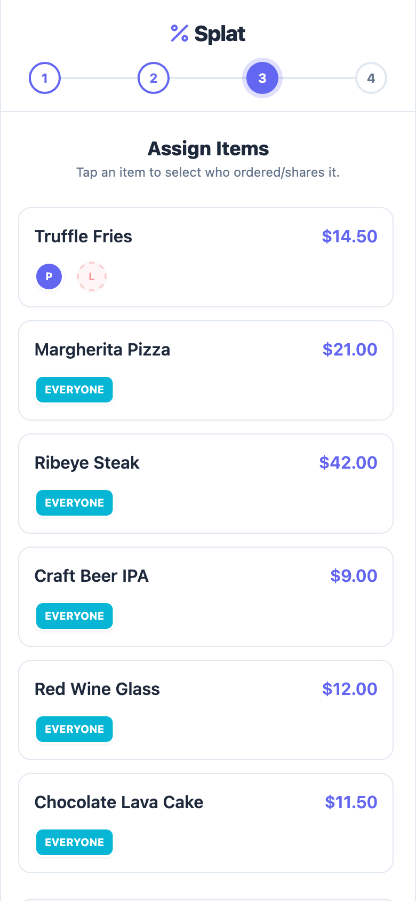
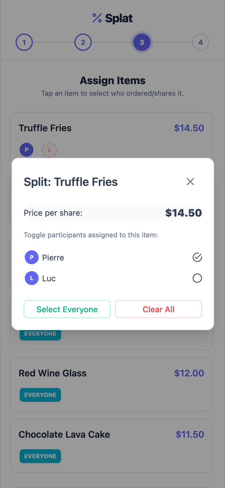

# Splat

Split a receipt based on what each person ordered. Splat turns a receipt photo into editable items, lets you assign shared dishes, and calculates each person's share of tax, fees, and tip.

**[Try the live app →](https://splat-bills.vercel.app/)**

Built with Vue and TypeScript for the web, with iOS and Android projects powered by Capacitor.

## App preview

| Assign items | Choose who shares an item |
| --- | --- |
|  |  |

## Features

- **Receipt scanning:** Extract items, adjustments, tips, and currency with Gemini, then review and edit the results.
- **Flexible splitting:** Assign items to one person, selected participants, or everyone; split quantities where needed.
- **Proportional totals:** Distribute tax, fees, and tips according to each person's subtotal, with rounding adjustments in the final breakdown.
- **Manual entry:** Build a receipt without using OCR.
- **Save and share:** Keep split history locally and copy an itemized summary into a messaging app.
- **Native integration:** Camera capture, clipboard, sharing, and RevenueCat purchase and restore flows through Capacitor.

## How it works

1. Scan a receipt or enter items manually.
2. Review the items, adjustments, and tip, then add participants.
3. Assign items and shared quantities.
4. Review each person's total and share the breakdown.

## Built with

| Layer | Technology |
| --- | --- |
| Interface | Vue 3, TypeScript, PrimeVue, Tailwind CSS |
| Tooling and tests | Vite, Vitest, Vue Test Utils |
| Native apps | Capacitor, Capgo OTA updates |
| OCR and API | Gemini, Vercel serverless functions |
| Usage and purchases | Redis, RevenueCat with server-side verification |

## Run locally

Use Node.js **20.19+** or **22.12+** and npm.

```bash
git clone https://github.com/MickRheault/splat.git
cd splat
npm ci
cp .env.example .env
npm run dev
```

Manual entry works without service credentials. OCR requires the server's `GEMINI_API_KEY` and Redis configuration. Native purchases require public RevenueCat SDK keys and server-side verification; see [billing setup](docs/billing.md).

`npm run dev` starts the frontend. To use your own API, set `VITE_API_BASE_URL` to its address. All `VITE_*` values are public in the built app; keep secret credentials in server environment variables.

| Command | Purpose |
| --- | --- |
| `npm run dev` | Start the frontend development server |
| `npm test` | Run the test suite |
| `npm run build` | Type-check and build the app |
| `npm run preview` | Preview the production frontend locally |

## Explore the code

- [`src/`](src/) — Vue interface, split calculations, and native integrations.
- [`api/`](api/) — OCR, usage, purchase synchronization, and webhooks.
- [`server/`](server/) — Shared billing verification and usage controls.
- [`docs/adr/`](docs/adr/) — Design decisions, including [rounding behavior](docs/adr/0004-display-only-itemized-rounding-policy.md).
- [`ios/`](ios/) and [`android/`](android/) — Native app projects.
